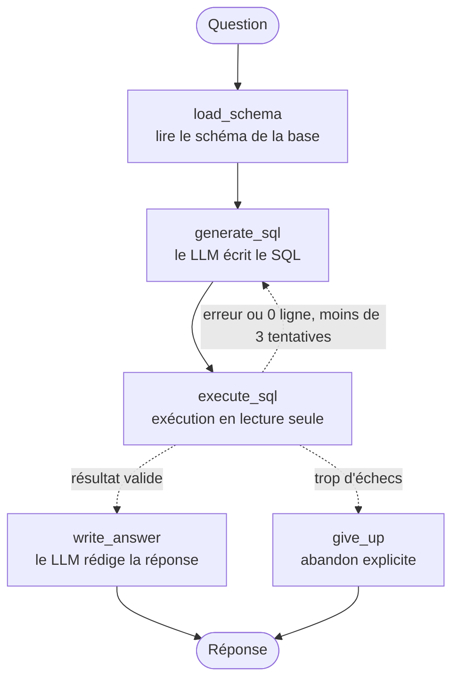

# DataPilot Agent

Agent Data Scientist connecté à une base de données SQL (text-to-SQL, analyse, ML).

## État du projet
- [x] Étape 1 : boucle agent minimale (question -> SQL -> exécution -> réponse)
- [ ] Étape 2 : LangGraph + auto-correction
- [ ] Étape 3 : schéma RAG + ML en sandbox
- [ ] Étape 4 : garde-fous + évaluation chiffrée

## Architecture de l'agent

Les flèches en pointillés sont des arêtes conditionnelles : le routeur choisit la suite selon l'état.