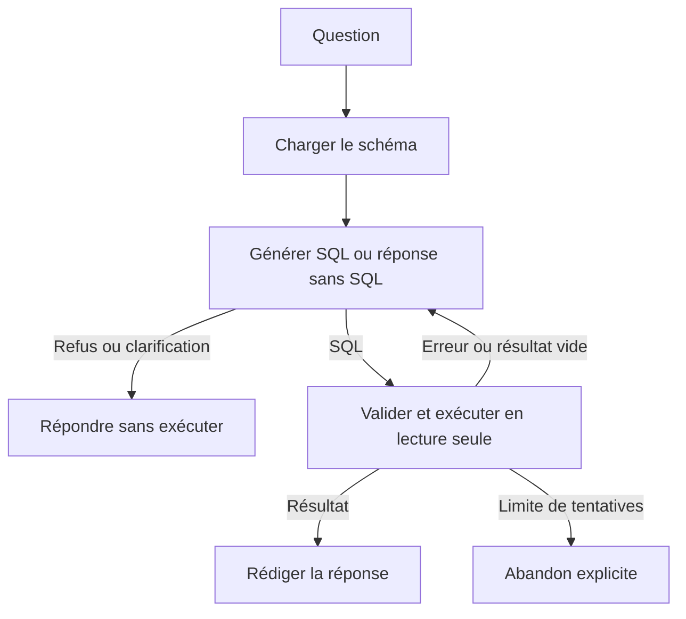

# DataPilot Agent

Agent conversationnel qui répond à des questions sur le jeu de données e-commerce Olist en générant des requêtes SQL SQLite.

## Fonctions

- Transforme une question en SQL, exécute la requête et formule une réponse en français.
- Utilise LangGraph pour corriger une requête en erreur et limiter le nombre de tentatives.
- Ouvre la base SQLite en lecture seule et bloque les requêtes de modification.
- Refuse les demandes dangereuses ou impossibles avec une explication.
- Demande une précision quand une question a plusieurs interprétations possibles.
- Propose une interface de démonstration avec Streamlit.

## Architecture



## Préparation

Prérequis : Python 3.10 ou plus récent, une clé API Gemini et les fichiers CSV du jeu Olist.

```powershell
python -m venv .venv
.\.venv\Scripts\Activate.ps1
pip install -r requirements.txt
pip install -e .
Copy-Item .env.example .env
```

Ajoutez votre clé à `.env` :

```dotenv
GEMINI_API_KEY=votre_cle_api
MODEL_NAME=gemini-3.5-flash-lite
FALLBACK_MODELS=gemini-3.5-flash,gemini-3.8-flash
```

Placez les CSV Olist dans `data/raw/`, puis créez la base :

```powershell
python scripts\load_db.py
```

## Lancer la démo Streamlit

Depuis la racine du dépôt, avec l’environnement virtuel activé et la base préparée :

```powershell
streamlit run app.py
```

L’interface affiche les réponses, le SQL généré et les lignes retournées. La clé API reste dans `.env` et n’est pas affichée dans l’interface.

## Utilisation en ligne de commande

```powershell
python scripts\ask_graph.py "Combien de commandes y a-t-il au total ?"
```

## Tests et évaluations

Tests unitaires :

```powershell
pytest
```

Évaluation SQL de 25 questions. Une pause aide à limiter les erreurs 429 de l’API :

```powershell
$env:EVAL_PAUSE = "4"
python scripts\run_eval.py --tag=mon_run
Remove-Item Env:EVAL_PAUSE
```

Comparer deux exécutions :

```powershell
python scripts\compare_runs.py mon_run autre_run
```

Évaluation de robustesse (données absentes, ambiguïté, demandes dangereuses) :

```powershell
python scripts\run_robustness.py --tag=robustesse
```

Les scripts enregistrent les résultats dans `eval/results/`. Les limites de débit et de quota du fournisseur peuvent provoquer des plantages ; ils sont consignés séparément des erreurs SQL.

## Résultats observés

Voir le [tableau comparatif détaillé](eval/comparison.md), avec les fichiers de résultats associés.

- Trois exécutions `gemini-3.5-flash-lite` : 25/25 chacune sur l’évaluation SQL, sans plantage.
- Après l’ajout des demandes de clarification : 25/25 sur une exécution de régression ; 25 tests unitaires passent.
- Jeu de robustesse : 10/10 sur les scénarios présents, dont une question ambiguë et quatre demandes dangereuses.
- L’exécution comparative de `gemini-3.5-flash` a réussi deux questions, puis q03 a expiré après épuisement du quota et surcharge du modèle de secours. Elle reste incomplète et n’est pas comparable aux runs lite.

Ces scores décrivent des exécutions ponctuelles sur un jeu de 25 questions ; ils ne garantissent pas les mêmes résultats à chaque appel du modèle.

## Limites et suites

Le prototype dépend d’une API externe : disponibilité, latence et quotas varient selon le fournisseur. La base et les réponses sont limitées au jeu Olist. Les volets RAG, apprentissage automatique, observabilité et déploiement ne font pas partie de cette démo.
